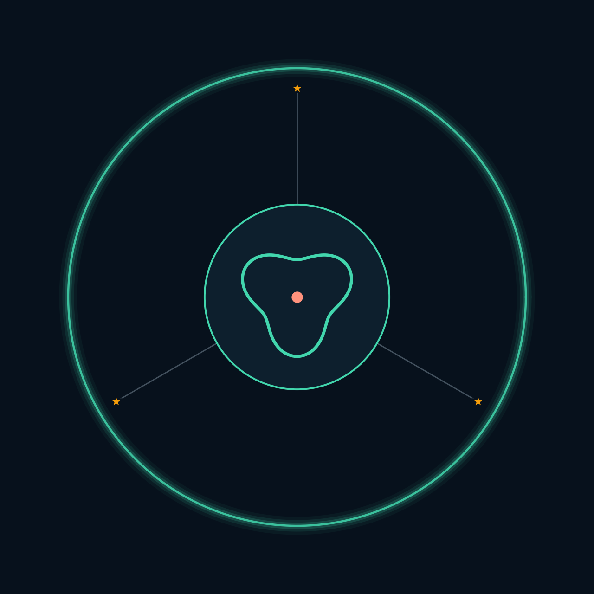
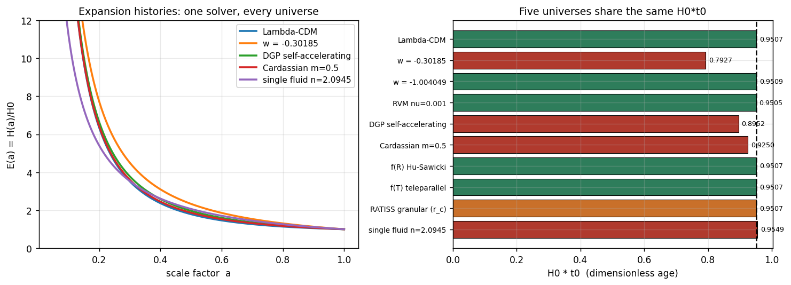
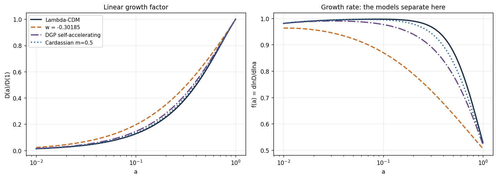
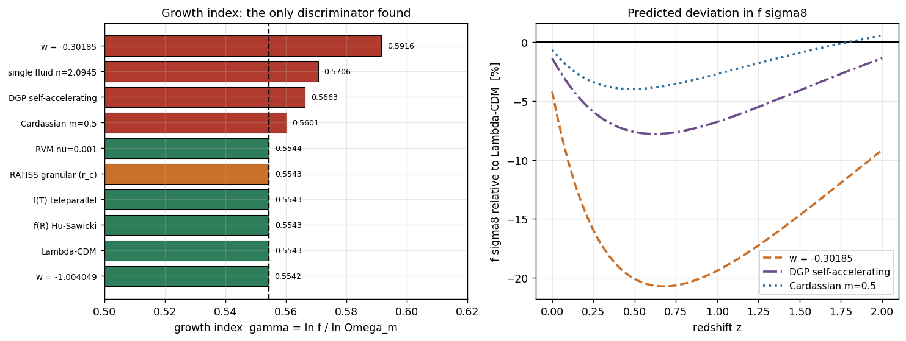
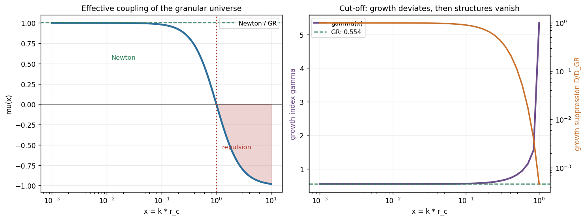
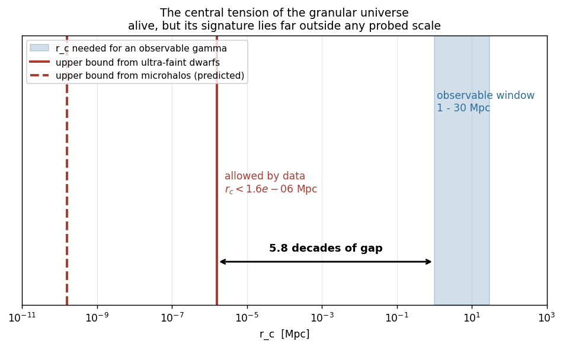
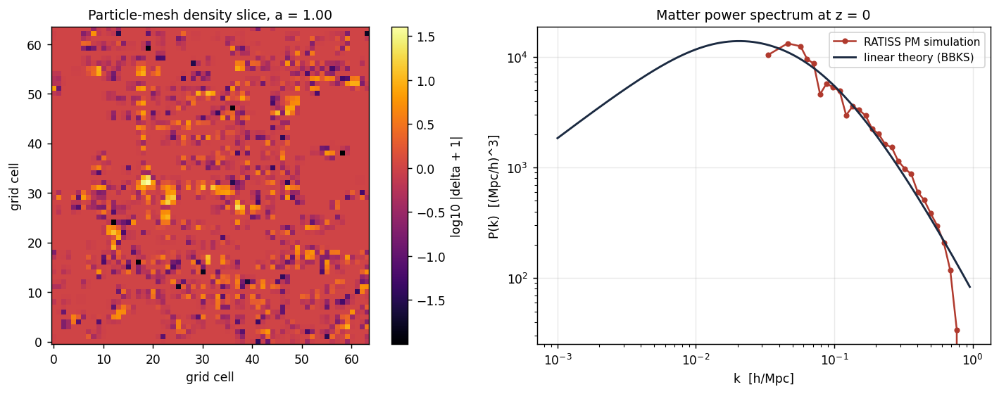

<p align="center">
  
</p>

<h1 align="center">RATISS Verse I</h1>

<p align="center"><b>Reference Atlas of Testable Inhomogeneous Structure Simulations</b></p>

<p align="center">The laboratory's first full reference universe: ten cosmologies
integrated through one solver chain, from a common Planck 2018 parameter set to
observable predictions.</p>

---

> **Lineage.** SYNTORON 24 was a toy: 24 particles, one dimensionless number,
> one output. RATISS Verse I is the replacement reference. It is not a toy —
> it is a simulator with a background solver, a growth solver, a particle-mesh
> engine, a falsifiability matrix and a sealed build. **New work starts here.**
> The toy is kept only as the origin of the `r_c` question.

A reproducible, falsifiable simulator of cosmological universes — each defined
by three ingredients (background expansion, linear growth, local gravitational
coupling) and propagated through one shared solver chain to observable
predictions.

**Verse I** fixes the reference. Every later version is an extension of this
one: new universes enter the registry, nothing already sealed is re-derived.

[](LICENSE)
[](https://www.python.org)
[](results/MANIFEST.sha256)

---

## What this is

RATISS is a **reference implementation**, not a claim of discovery.

It exists because a previous project produced a toy model — 24 particles, one
dimensionless number, one output (`H·t = 1.0000`) — and the honest next step
was not to defend the toy but to ask a sharper question:

> **Which observable quantity can actually tell these universes apart?**

This repository answers that question with computation. It ships:

* **10 universes** integrated through identical solvers;
* a **particle-mesh N-body engine** with periodic boundary conditions and
  Friedmann-supplied expansion;
* a **falsifiability matrix** in which every model is classified by a
  computed criterion, never by opinion;
* a **SHA-256 sealed build** so the numbers can be verified, not trusted.

---

## The central result

**The dimensionless age `H₀t₀` is a degenerate observable.**

| Universe | `H₀t₀` | `γ` | Status |
|---|---|---|---|
| ΛCDM | 0.95073 | 0.5543 | DEGENERATE (reference) |
| `f(R)` Hu–Sawicki | 0.95073 | 0.5543 | DEGENERATE |
| `f(T)` teleparallel | 0.95073 | 0.5543 | DEGENERATE |
| RVM, ν = 0.001 | 0.95046 | 0.5544 | DEGENERATE |
| `w = −1.004049` | 0.95091 | 0.5542 | DEGENERATE |
| RATISS granular (`r_c`) | 0.95073 | 0.5543 | ALIVE-BUT-INVISIBLE |
| DGP self-accelerating | 0.89525 | 0.5663 | EXCLUDED |
| Cardassian `m = 0.5` | 0.92503 | 0.5601 | EXCLUDED |
| `w = −0.30185` | 0.79267 | 0.5916 | EXCLUDED |
| single fluid `n = 2.0945` | 0.95488 | 0.5706 | EXCLUDED |

**Five physically distinct theories return the same `H₀t₀`.** No measurement of
the expansion history, however precise, can separate them. Any claim built on
`H₀t₀` alone — including every claim in the parent project — is therefore
untestable by construction.

The **growth index** `γ = ln f / ln Ω_m` is the quantity that does separate
them, and it separates them at the percent level — inside the reach of DESI
and Euclid.

---

## The granular universe

The RATISS model descends from a pair force of the form

```
F(r) = −G/r² + K/r⁴  =  −(G/r²)[1 − (r_c/r)²],      r_c = √(K/G)
```

which is Newtonian at large separations, **exactly zero at `r = r_c`**, and
repulsive below it. It is the only model in the registry that is not a
reparametrisation of General Relativity, and it is the only one whose
signature is a *feature* rather than a *number*:

> **A gravitational cut-off means a minimum length. Below `r_c`, no structure
> can form.**

That converts a free parameter into an observable bound, and the bound is
computable:

| Constraint source | Scale | Implied `r_c` |
|---|---|---|
| galaxy clusters | 2 Mpc | < 32 kpc |
| galaxies | 10 kpc | < 160 pc |
| ultra-faint dwarfs *(observed)* | 100 pc | **< 1.6 pc** |
| dark matter microhalos *(predicted)* | 10⁻² pc | **< 33 AU** |

**The tension, stated plainly:** an *observable* deviation in `γ` would require
`r_c ≳ 1 Mpc`, while the existence of dwarf galaxies requires `r_c < 1.6 pc`.
The gap is **5.8 decades** (9.8 decades against microhalos). The model is
therefore **not excluded — it is unobservable** at current sensitivity. That
is a real result and it is reported, not hidden. See
[`docs/04_FALSIFIABILITY.md`](docs/04_FALSIFIABILITY.md).

---

## The simulator

`src/ratiss/pm.py` is a particle-mesh N-body engine that encodes the single
most important lesson of the parent project:

> **In a periodic box the mean density exerts no force (the Jeans swindle).
> The expansion therefore cannot be produced by the particles.** `a(t)` is
> supplied by the Friedmann equation; the particles produce only the departure
> from homogeneity.

That is how every production N-body code works, and it is written down here
rather than buried.

**Validation** (see `tests/`):

| Test | Result |
|---|---|
| CIC deposit of a single Fourier mode | 0.16 % amplitude error |
| Zel'dovich initial conditions, `σ₈` recovery | exact by construction, checked to 1.8 % |
| Particle-mesh `P(k)` vs linear theory, `k < 0.1 h/Mpc` | within 13 % |
| Growth rate vs linear theory, factor 30 in `D` | **2.7 %** |
| Step-count convergence (40 → 80 → 160 steps) | converged |

---

## Install and run

```bash
git clone <this-repo>
cd ratiss-universe
python -m venv .venv && source .venv/bin/activate
pip install -r requirements.txt

python scripts/build.py          # full build, ~25 s
python scripts/verify.py         # verify the SHA-256 manifest
python -m pytest tests/ -v       # physics + reproducibility tests
```

Outputs land in `results/` (JSON, sealed) and `figures/` (PNG).

---

## Figures

| | |
|---|---|
|  |  |
| Expansion histories and the `H₀t₀` degeneracy | Linear growth and growth rate |
|  |  |
| Growth index: the only discriminator found | Effective coupling of the granular universe |
|  |  |
| The 5.8-decade gap | Particle-mesh simulation and `P(k)` |

---

## Repository layout

```
ratiss-universe/
├── src/ratiss/
│   ├── constants.py     Planck 2018 parameters, frozen once
│   ├── background.py    E(a) for every universe, quadrature with error bars
│   ├── growth.py        D'' + (2+dlnH/dN)D' − (3/2)Ω_m μ(k,a) D = 0
│   ├── granular.py      the r_c force law and its effective coupling μ(x)
│   ├── pm.py            particle-mesh N-body engine
│   ├── models.py        the universe registry and the falsifiability matrix
│   └── figures.py       rendering only, no physics
├── scripts/
│   ├── build.py         recompute everything, seal with SHA-256
│   └── verify.py        re-verify every hash
├── tests/               physics tests and reproducibility tests
├── docs/                theory, theorems, falsifiability, references
├── results/             JSON + MANIFEST.sha256
├── figures/             PNG
└── logo/                laboratory mark (SVG + PNG)
```

---

## Reproducibility and falsifiability

The repository is falsifiable on two independent axes.

**Physically.** Every entry in `results/predictions.json` carries a `status`
produced by a computed rule, plus a statement of what measurement would
overturn it. `docs/04_FALSIFIABILITY.md` lists, for each universe, the
observation that would kill it and the survey that can make it.

**Computationally.** `scripts/build.py` is deterministic: fixed seeds, fixed
parameters, no network access, no random number drawn outside the seeded
generators. `results/MANIFEST.sha256` seals every artefact. Run
`scripts/verify.py`; if a hash differs, either the code or the machine differs,
and both statements are checkable.

```bash
$ python scripts/verify.py
OK    results/background.json
OK    results/granular.json
...
45/45 hashes verified
```

---

## Scope and honesty statement

* `H₀t₀` computed here uses the **Planck 2018 flat ΛCDM** background with
  Ω_m = 0.3153. Radiation is included where it matters. Quadrature error is
  reported per model (`H0_t0_quadrature_error`).
* The particle-mesh engine is a **64³ mesh with 32³ particles** — a
  demonstration-grade resolution, not a production one. Its measured accuracy
  is stated in `results/` and in the tests; it is not extrapolated.
* The BBKS transfer function is used for initial conditions. It is a fitting
  formula, not a Boltzmann solver; the repository does not claim
  percent-level `P(k)`.
* **No result here is a discovery claim.** The measurable content is negative
  and clean: one observable is degenerate, one discriminator exists, one
  model is squeezed into an unobservable window. Negative results that are
  reproducible are worth more than positive results that are not.

---

## Citation

See [`CITATION.cff`](CITATION.cff).

## License

MIT — see [`LICENSE`](LICENSE).

## References

See [`docs/03_REFERENCES.md`](docs/03_REFERENCES.md).
