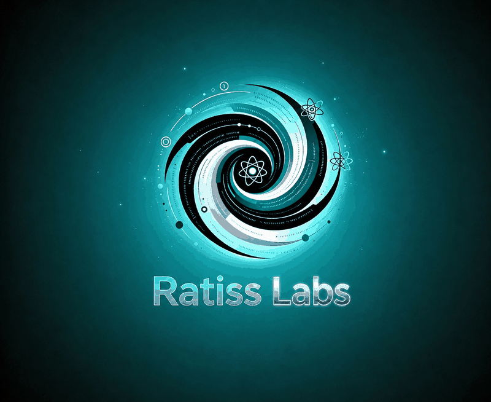

# Laboratory mark

<p align="center">
  
</p>

**This is the existing RATISS Labs logo. It has not been redrawn, regenerated,
recoloured or restyled for this repository — the file is reproduced unchanged.**

| | |
|---|---|
| Source repository | [jonathansearch/RATISS-Framework](https://github.com/jonathansearch/RATISS-Framework) |
| Source path | `docs/img/logo-ratiss-labs.png` |
| Format | PNG, 800 × 654 |
| File size | 224342 bytes |
| SHA-256 | `a710c8d1517b470f70716ae0aeadf98abadf30e2f43cbd1fd02c638670a83130` |

## Verify that this is the same file

```bash
curl -sL https://raw.githubusercontent.com/jonathansearch/RATISS-Framework/main/docs/img/logo-ratiss-labs.png \
  | sha256sum
# expected: a710c8d1517b470f70716ae0aeadf98abadf30e2f43cbd1fd02c638670a83130
```

Design: glass vortex with an atomic sphere at its centre, instrumental orbits
around it, and the wordmark *Ratiss Labs* beneath.
